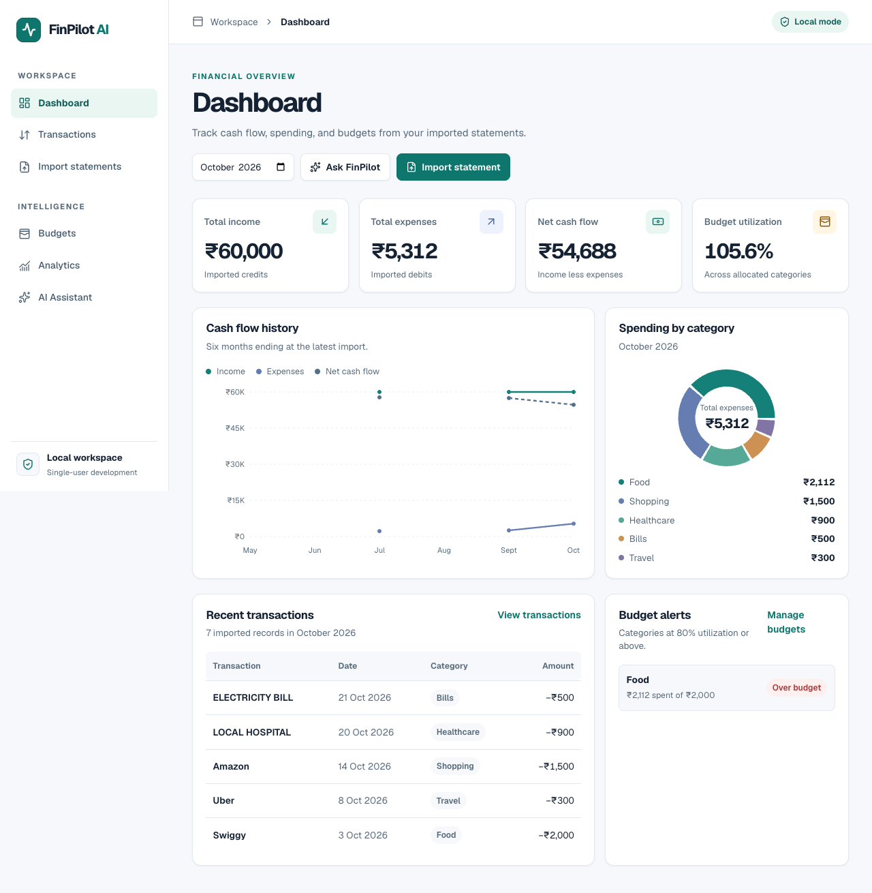

# FinPilot AI

FinPilot AI is a local personal finance workspace. Import a bank statement, review cash flow and spending patterns, set monthly budgets, and ask an AI assistant about the records you imported.

**Next.js · FastAPI · SQLite · Google ADK · Gemini · Docker Compose**



[View the analytics screenshot](docs/screenshots/analytics.png) · [Read the production-readiness guide](docs/production-readiness.md)

## What you can do

| Page | What it does |
| --- | --- |
| **Dashboard** | See income, expenses, net cash flow, category breakdowns, and budget alerts for a selected month. |
| **Transactions** | Search descriptions and merchants, filter by month, category, or type, and browse paginated records. |
| **Import statements** | Upload CSV or XLSX files, review rejected rows, and see duplicate and overlap notifications. |
| **Budgets** | Set category allocations by month and see spending, remaining amounts, and utilization. |
| **Analytics** | Compare periods, review cash-flow trends, and inspect spending outliers and savings observations. |
| **AI Assistant** | Ask about imported records through the FinPilot coordinator and its transaction, budget, and expense specialists. Conversations persist in SQLite. |

## Quick start with Docker

Use Docker with Compose and Python 3.12. Run these commands from the repository root.

```bash
python3.12 -m venv .venv
source .venv/bin/activate
python -m pip install -r requirements.lock
python -m scripts.configure_local
docker compose config --quiet
docker compose up --build -d
```

Open [http://localhost:3000/login](http://localhost:3000/login) and use the password you chose during setup. The setup command stores the password hash, signing keys, and Gemini key in the Git-ignored `.secrets/` directory. Existing secret files are preserved.

For finance features without Gemini, run `python -m scripts.configure_local --without-gemini` during setup and start with `FINPILOT_REQUIRE_GEMINI=0 docker compose up --build -d`. Sign-in, imports, budgets, and analytics work without a Gemini key. AI replies require working credentials and provider access.

Stop with `docker compose down`. The named volume retains financial records, budgets, conversations, and login sessions. Use the [production-readiness guide](docs/production-readiness.md) for configuration, health checks, and recovery into a separate volume.

### Try it with sample data

In a demo workspace, open **Import statements** and upload [the synthetic analytics statement](sample_data/analytics_statement.csv). Select **October 2026** on the dashboard.

| Metric | Expected value |
| --- | ---: |
| Income | ₹60,000 |
| Expenses | ₹5,312 |
| Net cash flow | ₹54,688 |

Set the October food budget to **₹2,000** to see **105.6% utilization**. In Analytics, compare September with October, or select August 2026 to see how the app handles a month without imported records. With Gemini configured, try asking “What were my imported expenses in October 2026?”

## How it works

```text
Browser → Next.js API proxy → FastAPI → SQLite
                                 └──→ Google ADK coordinator → Gemini
                                        └── Specialists → read-only finance tools
```

- **Statement processing** validates CSV/XLSX files, categorizes transactions with local rules, and stores amounts as integer paise. Exact reimports are skipped. Possible overlaps from different files are retained and flagged for review.
- **Analytics** use Python and SQL to calculate totals, comparisons, and budget utilization. Months without records remain missing. Outlier detection uses a modified Z-score against prior spending in the same category and reports when the baseline is insufficient.
- **Assistant** delegates to the Transaction Analyst, Budget Planner, or Expense Insights specialist. Their tools read stored records. Budget changes require an explicit action in the app or CLI.
- **Access and storage** use a single local account, Argon2id password verification, revocable sessions, and CSRF protection for authenticated writes. Docker publishes only the frontend on loopback. Financial records, ADK conversations, and login sessions use separate SQLite files.

### Statement format

Use UTF-8 CSV or the first worksheet of an XLSX file, up to 5 MiB. Include the headers `date`, `description`, `debit`, and `credit`. Use an unambiguous date such as `2026-10-02` and put a positive INR amount in exactly one of the debit or credit columns. For a template, see [the sample CSV](sample_data/sample_statement.csv).

## Develop without Docker

Use Python 3.12 and Node.js 24 to match the container runtimes. Create the virtual environment and configure local credentials as shown above, then run the backend and frontend in separate terminals.

```bash
# Backend, from the repository root with the virtual environment active
uvicorn backend.main:app --reload --port 8000 --no-access-log
```

```bash
# Frontend
cd frontend
npm ci
npm run dev
```

The frontend uses a server-side proxy to reach the backend. Optional settings are documented in the [backend](backend/.env.example) and [frontend](frontend/.env.example) environment templates. For agent development, use `adk web --port 8001` on loopback with synthetic data.

| Directory | Contents |
| --- | --- |
| [`finance_agent/`](finance_agent/) | ADK agents, statement processing, and finance calculations |
| [`backend/`](backend/) | FastAPI routes, authentication, and configuration |
| [`frontend/`](frontend/) | Next.js frontend, API proxy, and Playwright tests |
| [`scripts/`](scripts/) | Setup, import, budgets, backup, restore, and Compose smoke test |
| [`tests/`](tests/) and [`evaluations/`](evaluations/) | Python regression tests and synthetic ADK evaluations |

## Verify locally

```bash
python -m unittest discover -s tests -v
python -m evaluations.run --validate
python -m scripts.smoke_compose
```

The Compose smoke test runs in an isolated project with synthetic data and separate volumes. For browser tests, free ports 3000 and 8000 first.

```bash
cd frontend
npm run lint
npm run typecheck
npm run build
npx playwright install chromium
npm run test:e2e
```

The Phase 7 verification run passed 68 Python tests, four Chromium journeys, and the local Compose smoke test. The ADK evaluation schema validated eight cases. Live evaluation stopped after the first case returned Gemini HTTP 504. See the [verification report](docs/production-readiness.md#readiness-status) for audit results and outstanding checks.

## Privacy and deployment scope

FinPilot is designed for authenticated, single-user use on localhost. Keep real statements, backups, and secret files outside Git. Financial data and conversations are stored locally in unencrypted SQLite files. Using the assistant sends chat inputs and selected tool results to Gemini. An anomaly flag can prompt a review and cannot establish fraud.

For operational details, see the [production-readiness guide](docs/production-readiness.md).
